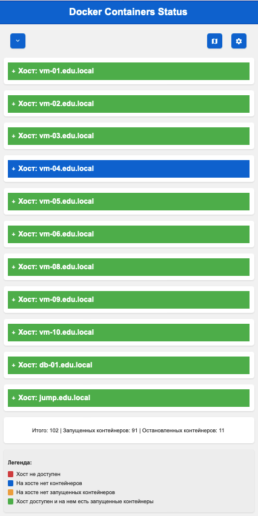
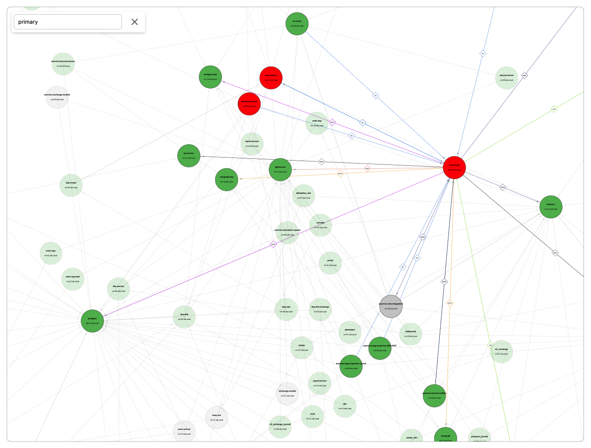

CMAP (Container Mapping and Analysis Platform) — это веб-приложение, предназначенное для визуализации инфраструктуры Docker-контейнеров. Оно предоставляет удобный интерфейс визуализации взаимосвязей между контейнерами.




### Основные возможности:
- **Интерактивная карта**: отображение контейнеров и их связей (включая взаимодействия с внешними сервисами).

- **Визуализация связей**: основана на использовании лейблов `connect_to` в Docker-контейнерах для обозначения логических связей.

- **Поле поиска узлов на карте**: позволяет пользователю искать контейнеры по именам, по мере ввода текста происходит подсветка найденных узлов красным цветом.



### Что такое `connect_to`?
Лейбл `connect_to` — это метка, добавляемая к Docker-контейнеру, указывающая его связи с другими контейнерами или внешними сервисами. Она используется для визуализации связей на карте инфраструктуры CMAP.

#### Формат лейбла `connect_to`:
Лейбл записывается в формате `service_name:port`, где:
- `service_name` — имя целевого сервиса или контейнера.
- `port` — порт целевого сервиса.

Если требуется указать несколько связей, их можно перечислить через запятую:
```
connect_to=db-service:80,external-service:8080
```

#### Настройка `connect_to`:
1. **При запуске контейнера**:
   ```bash
   docker run -d \
     --name my-container \
     --label connect_to=db-service:5432,auth-service:8080 \
     my-image
   ```
2. **Через `docker-compose.yml`**:
   ```yaml
   version: '3.8'
   services:
     app:
       image: my-image
     labels:
       connect_to: "db-service:5432,auth-server:8080"
   ```

### Для работы карты используется порт на удалённом хосте
Для обеспечения корректной работы CMAP и связи с удалёнными Docker-хостами, порт, указанный для доступа к API Docker `2375`, должен быть открыт на удалённом хосте. Это позволяет приложению взаимодействовать с Docker Engine.

#### Пример настройки:
- Для открытия порта `2375` на удалённом хосте убедитесь, что:
  - Включён удалённый доступ к Docker Daemon.
  - В файле `/etc/docker/daemon.json` добавлено:
    ```json
    {
      "hosts": ["tcp://0.0.0.0:2375", "unix:///var/run/docker.sock"]
    }
    ```
  - Выполнена перезагрузка Docker:
    ```bash
    systemctl daemon-reload
    systemctl restart docker

    ```

#### Для выгрузки приложения через gitlab-runner: 
  - Для деплоя на виртуальной машине не забываем править права 
    ```bash
    sudo chown -R gitlab-runner:gitlab-runner /data/service/cmap
    sudo chmod -R 755 /data/service/cmap
    ```
Настроить sudo без пароля для пользователя Runner

  - Откройте файл конфигурации sudoers:
    ```bash
    sudo visudo
    ```

  - Добавьте следующую строку:
    ```bash
    gitlab-runner ALL=(ALL) NOPASSWD: ALL
    ```
    
Это позволит пользователю gitlab-runner выполнять команды sudo без запроса пароля.


