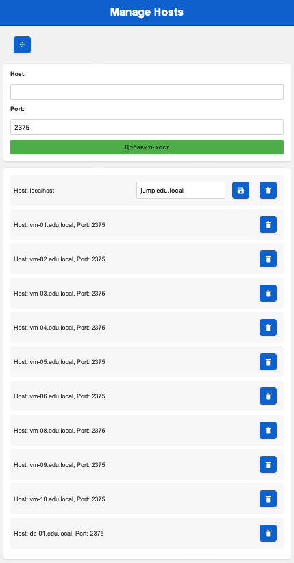

# CMAP

**Container Mapping and Analysis Platform** — карта Docker-контейнеров и связей по лейблу `connect_to`.


## Возможности

- **Контейнеры** — список по хостам, поиск, фильтр running/stopped; имя открывает узел на карте (`/map?node=…`)
- **Карта** — D3-граф, кластер по compose `project`, фильтры и шторка узла по запросу, Fit/zoom, покрытие без `connect_to`, soft-refresh ~20с
- **Хосты** — `localhost` через docker.sock (RO); удалённые Docker API по желанию

## Быстрый старт

Нужны Docker и доступ к `/var/run/docker.sock`.

```bash
git clone <repo-url> cmap
cd cmap
mkdir -p instance
docker compose -f docker-compose.standalone.yml up -d --build
open http://127.0.0.1:5000
```

Проверка:

```bash
curl -s http://127.0.0.1:5000/healthz
```

Данные хостов хранятся в `instance/hosts.db` (каталог в git не коммитится).

Локальная разработка без Docker:

```bash
cd app
python -m venv .venv && source .venv/bin/activate
pip install -r requirements.txt
cp .env.example .env
mkdir -p ../instance
FLASK_APP=main:app flask run -p 5000
```

## Лейбл `connect_to`

Формат: `service:port` (несколько через запятую).

Резолв цели: точное имя контейнера → `com.docker.compose.service` в том же project → уникальный service → fuzzy по имени. Нерезолвнутые цели становятся external-узлами.

```yaml
services:
  app:
    image: my-image
    labels:
      connect_to: "db:5432,redis:6379,traefik:443"
```

```bash
docker run -d --name my-app --label connect_to=db:5432 my-image
```

## Скриншоты

| Список | Хосты |
|---|---|
|  |  |

## Удалённые Docker-хосты

Для LAN предпочтительнее TLS или SSH/docker context. Открытый TCP `2375` без TLS — только в доверенной сети за firewall.

## Деплой за Traefik

Продакшен-compose с лейблами Traefik и allowlist: [`docker-compose.yml`](docker-compose.yml).  
Операционка tx0: [`INSTRUCTION.md`](INSTRUCTION.md).

## Лицензия

[MIT](LICENSE)
